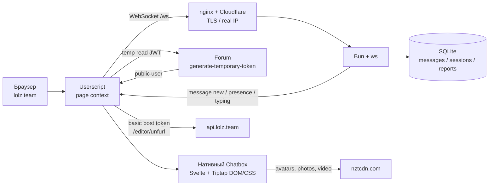
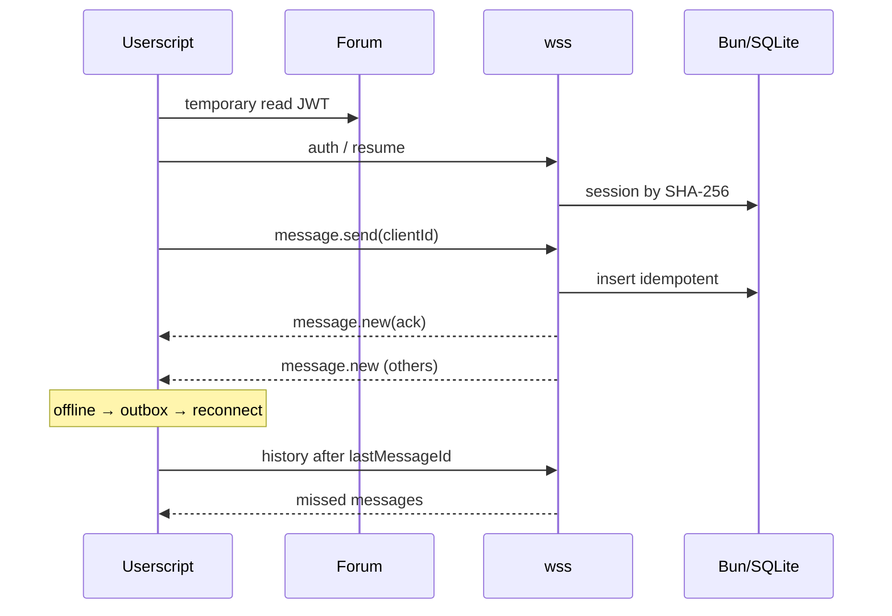

# No Rules

Отдельная комната внутри нативного Chatbox Lolzteam: тот же Svelte-интерфейс,
Tiptap, reply/edit-бары, контекстное меню и мобильные жесты, но свои сообщения
и собственный WebSocket-сервер.

- Userscript: <https://raw.githubusercontent.com/9sx77ssl/lzt-no-rules/main/extension/dist/no-rules.user.js>
- Репозиторий: <https://github.com/9sx77ssl/lzt-no-rules>
- WSS: `wss://lztws.d9v.uk/ws`
- Health: <https://lztws.d9v.uk/health> · Version: <https://lztws.d9v.uk/version>
- Версия: **1.3.5**

> Это не E2E. Сообщения хранятся в SQLite у владельца сервера. Пароль,
> cookies форума и платёжные данные на backend не отправляются.

## Что умеет

- Комната **No Rules** в боковом меню Chatbox, прямой `#no-rules`, виджет.
- Отправка, edit, delete, reply с полным HTML, mention, ArrowUp-edit,
  одинаковые сообщения подряд.
- Нативные карточки: market-разделы 24 px, форумные/медиа/аккаунты, фото
  через fancybox, XenForo-плеер, смайлы 96×96.
- BBCode: URL, IMG (включая `[IMG=width=...;height=...]`), MEDIA, VIDEO,
  UNFURL и USER. Остальные теги остаются обычным текстом вместе со скобками.
- Pending-сообщения и ошибки отправки как в нативном Chatbox; переход к reply
  грузит компактное окно истории `history near`.
- История, unread, typing, онлайн, мобильный вид и сохранение скролла при
  переключении комнат.
- Outbox переживает обрыв и F5; `clientId` не даёт создать дубль; после
  `rate_limited` очередь повторяется сама.
- Жёсткий лимит **512 символов** в composer-е и на сервере: вставка из
  буфера, IME и drag-drop не обходят ограничение.
- Автоскролл остаётся внизу после загрузки фото/видео/эмодзи; соло-смайл
  96×96 и копируется как `:shortcode:`.
- В редакторе смайлы всегда 32×32, после отправки не остаются NodeView,
  а при редактировании курсор сразу ставится в конец сообщения.
- Один typed-хелпер `mountNativeModal` для онлайн-списка и отладки сокета:
  backdrop, блокировка body, плавное открытие/закрытие, X, клик вне, Escape.
- Контекстное меню повторяет нативную `rise`-анимацию: 100 мс, fade +
  `translateY(10px)`; сообщения входят нативной `fly`-анимацией.
- Индикатор сокета рядом с названием комнаты; клик открывает отладочную
  модалку WebSocket/auth/history/outbox.

## Архитектура





Backend не проксирует сообщения через форум: это отдельный процесс Bun/`ws` с
SQLite. Userscript только читает нативный DOM и подменяет список сообщений.

## Структура

```text
extension/src/       00-core, 10-ui, 20-messages, 30-ws, 40-main
extension/dist/      собранный no-rules.user.js
server/src/          Bun/Node backend, auth, sanitize, ws, db
server/tests/        unit-тесты
deploy/              systemd, nginx, update.sh
docs/                PROJECT.md, OPERATIONS.md, CHANGELOG.md
research/            сохранённые JS-чанки Chatbox для реверса
```

## Установка

1. Поставь Tampermonkey или Violentmonkey.
2. Открой raw-ссылку и подтверди установку.
3. Удали старые копии No Rules (`1.0.1`, `1.1.8`, другой `@namespace`).
4. Открой `https://lolz.team/chatbox/` → **No Rules** в боковом меню.

Firefox/Tampermonkey: используется page-context `fetch`/WebSocket; `Origin:
null` принимается сервером только вместе с read-JWT и `ACCESS_KEY`.

## Локальный backend

```bash
git clone https://github.com/9sx77ssl/lzt-no-rules.git
cd lzt-no-rules
cp .env.example ../.env
# ACCESS_KEY, ALLOWED_USER_IDS, DB_PATH
cd server
bun install
bun run start
```

Проверка: `curl -fsS http://127.0.0.1:8787/health`.

## Сборка и релиз

```bash
NR_VERSION=1.3.5 \
NR_WS_URL=wss://lztws.d9v.uk/ws \
NR_ACCESS_KEY='<production key>' \
node scripts/build-extension.mjs

node --check extension/dist/no-rules.user.js
cd server && npm test && npm run typecheck
```

Публикация: `git push origin main`, затем
`ssh <production-host> '/opt/no-rules/update.sh'`. Скрипт делает `git pull`,
`bun install --production`, restart systemd и проверяет `/health`; при ошибке
откатывается на предыдущий commit. После пуша сверь SHA-256 raw-файла с
локальным `extension/dist/no-rules.user.js`.

## BBCode и карточки

Форматируются только `URL`, `IMG`, `MEDIA`, `VIDEO`, `UNFURL`, `USER`.
Остальные BBCode-теги не трогаются и остаются текстом вместе со скобками.
Tiptap-хвосты удаляются, поэтому карточки не растягивают сообщение;
`market_search` приводится к legacy-карточке 24 px. Подробно:
[`docs/PROJECT.md`](docs/PROJECT.md#6-bbcode-и-карточки).

## Безопасность

- Временный токен только `read`/`chatbox`; сервер не может писать, банить или
  переводить.
- Пароль, cookies, `_xfToken`, CSRF, `xf_user`, `xf_session` не уходят.
- `basic post` для `/editor/unfurl` остаётся в браузере.
- В БД только SHA-256 от нашей сессии; forum-JWT не хранится и не логируется.
- Серверный и клиентский HTML-санитайзеры, rate limit, Origin allowlist,
  лимит WS-кадра, проверка `is_banned` при resume.
- Медиа — только `https` и разрешённые форумные хосты.
- IP виден nginx/Cloudflare, в SQLite не пишется.
- Сетевые дампы, DOM-снимки, antibot, `.env`, БД и `storageState` в git не
  попадают; из research коммитятся только JS-чанки.

Полная модель угроз: [`docs/OPERATIONS.md`](docs/OPERATIONS.md#5-auth-и-безопасность).

## Тесты

```bash
for f in extension/src/*.js; do node --check "$f"; done
node --check extension/dist/no-rules.user.js
cd server && npm test && npm run typecheck
```

`npm test` — **27/27**. Playwright-сценарии: Chromium desktop/mobile, Firefox,
full chat + widget, F5, outbox/reconnect, BBCode/cards, video/lightbox/smilies,
copy, online/socket modals, room switch. Чек-лист:
[`docs/OPERATIONS.md`](docs/OPERATIONS.md#9-тестирование).

## Документация

- [`docs/PROJECT.md`](docs/PROJECT.md) — extension, native Chatbox, BBCode,
  рендер, видео, меню, модалки, typing.
- [`docs/OPERATIONS.md`](docs/OPERATIONS.md) — backend, протокол, БД,
  безопасность, деплой, тесты.
- [`docs/CHANGELOG.md`](docs/CHANGELOG.md) — архив истории версий.
- [`FORUM-THEME.md`](FORUM-THEME.md) — текст темы/анонса для форума.
- [`research/README.md`](research/README.md) — сохранённые JS-чанки.

## Ограничения

- Нет E2E; SQLite доступна владельцу сервера.
- Нет push-уведомлений; только browser notification при разрешении.
- Скрытые BBCode-теги, зависящие от прав форума (`CLUB`, `DAYS`, `LIKES`,
  `API`), не раскрываются клиентом.
- Production на systemd + Bun, без Docker.

Автор: [gay1234](https://lolz.team/gay1234/) / [9sx77ssl](https://github.com/9sx77ssl)
